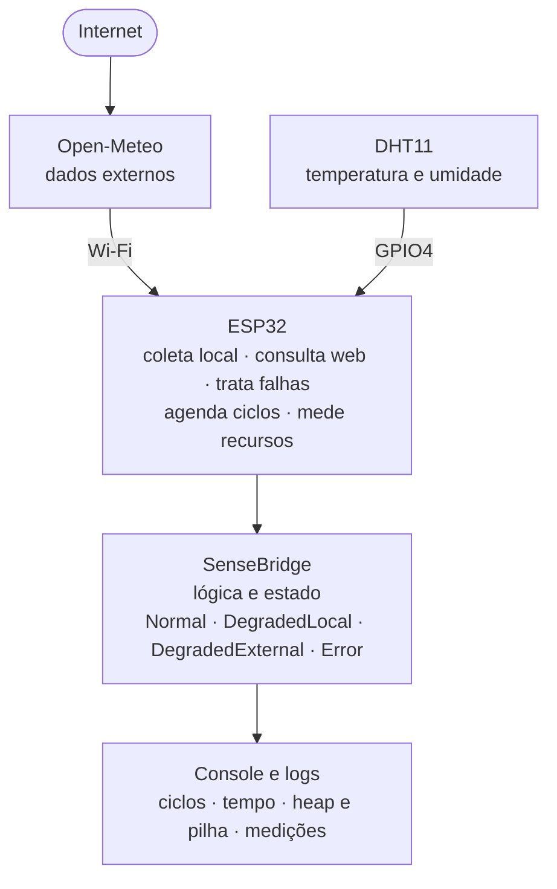
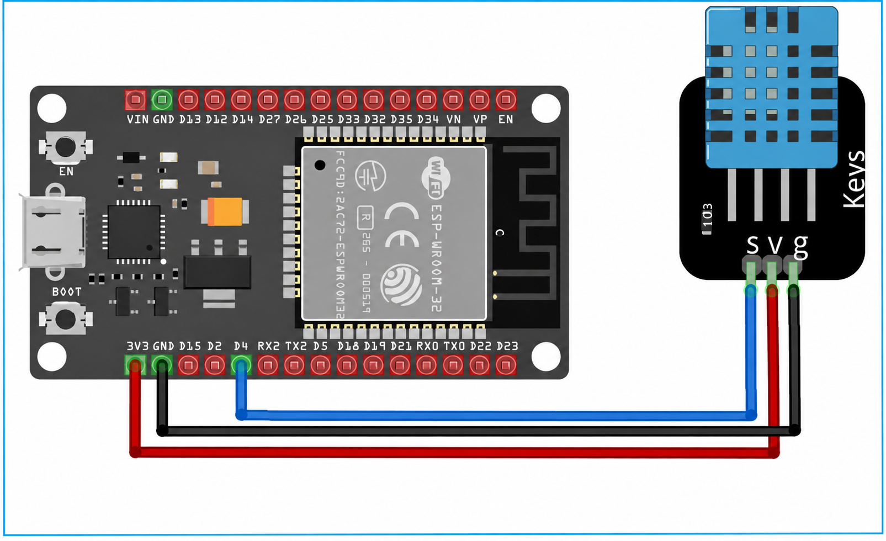

# SenseBridge

[](https://github.com/msc-sed-ufrr/SenseBridge/actions/workflows/ci.yml)

**SenseBridge** é uma biblioteca de software embarcado desenvolvida em **Rust** para integração resiliente de dados ambientais em sistemas baseados em **ESP32**.

O projeto é desenvolvido no contexto da disciplina de **Arquitetura e Organização de Computadores**, do Mestrado Profissional em Computação Aplicada da Universidade Federal de Roraima — PPCA/UFRR, na trilha PTT4 — Biblioteca de software embarcado.

## Objetivo

Desenvolver e validar uma biblioteca embarcada capaz de integrar dados ambientais provenientes de uma fonte local e de uma fonte externa, mantendo comportamento definido diante de falhas de leitura ou indisponibilidade das fontes.

A implementação de referência utiliza:

- ESP32;
- sensor DHT11 para temperatura e umidade;
- API Open-Meteo como fonte externa de dados meteorológicos;
- linguagem Rust.

## O que a biblioteca faz

A cada ciclo, a biblioteca `sense_bridge`:

- obtém a leitura da fonte local e a da fonte externa, por meio de traits implementadas pela plataforma;
- valida os valores recebidos e impede que um valor inválido apareça como válido;
- identifica a origem de cada valor e, quando uma fonte falha, o tipo da falha;
- opera de forma degradada quando apenas uma fonte está disponível;
- sinaliza explicitamente o estado de erro quando as duas fontes estão indisponíveis;
- retorna à operação normal no primeiro ciclo em que as duas fontes voltam.

A biblioteca é `no_std`, não aloca memória e não tem dependências. O uso da API está no [README da crate](sense-bridge/README.md).

## Resultados

| Cenário | DHT11 | Open-Meteo | Estado esperado | Resultado no ESP32 (5 repetições de 10 ciclos) |
| --- | --- | --- | --- | --- |
| C1 — Operação normal | Disponível | Disponível | `Normal` | 50/50 ciclos em `Normal` |
| C2 — Falha local | Indisponível | Disponível | `DegradedLocal` | 50/50 ciclos em `DegradedLocal` |
| C3 — Falha externa | Disponível | Indisponível | `DegradedExternal` | 50/50 ciclos em `DegradedExternal` |
| C4 — Falha simultânea | Indisponível | Indisponível | `Error` | 50/50 ciclos em `Error` |
| C5 — Recuperação | Recuperado | Recuperado | Retorno a `Normal` | 5/5 recuperações no primeiro ciclo com as duas fontes válidas |

- **Testes automatizados:** 62, executados sem hardware, cobrindo C1–C5, validação, transições e a interpretação de respostas reais da Open-Meteo.
- **Latência:** ciclos sem consulta externa entre 18 e 22 ms.
- **Memória:** cerca de 23,3 KiB de Flash e 13,2 KiB de RAM estática a mais que um firmware-base sem a biblioteca.

A metodologia e os números completos estão na [avaliação experimental](docs/03-avaliacao-experimental.md). O projeto não inclui medição de consumo energético.

## Arquitetura



Componentes, fluxo do ciclo, princípios e decisões de arquitetura estão em [docs/02-arch.md](docs/02-arch.md).

## Estrutura

```text
SenseBridge/
├── Cargo.toml          # workspace: biblioteca e ferramentas de host
├── sense-bridge/       # biblioteca (no_std, independente de hardware), preparada para o crates.io
│   ├── src/
│   ├── tests/          # cenários C1–C5 com fontes simuladas e respostas gravadas da Open-Meteo
│   ├── examples/
│   ├── CHANGELOG.md
│   └── README.md       # documentação da crate
├── tools/
│   └── console/        # console de host: acompanha os ciclos pela serial e grava as capturas
├── firmware/           # casos de uso, um projeto por placa (não publicados)
│   └── esp32/          # DHT11 + Open-Meteo
├── docs/               # projeto de pesquisa, PRD, arquitetura, avaliação, relatório e evidências
├── scripts/
│   └── evidencias.sh   # gera docs/evidencias/verificacao.md
├── capturas/           # capturas de trabalho gravadas pelo console (ignoradas pelo git)
├── .github/workflows/  # CI: formatação, clippy, testes, documentação e pacote
├── README.md           # este arquivo: o projeto de pesquisa
├── LICENSE-APACHE
└── LICENSE-MIT
```

## Como reproduzir

### 1. Testes sem hardware

Requer apenas o Rust, instalado pelo [rustup](https://rustup.rs) (versão 1.85 ou mais recente). Na raiz do repositório:

```sh
cargo test                                     # 62 testes da biblioteca e do console, com C1–C5
cargo clippy --all-targets -- -D warnings      # análise estática
cargo run -p sense_bridge --example simulate   # imprime os cenários simulados em CSV
scripts/evidencias.sh                          # registra tudo em docs/evidencias/verificacao.md
```

### 2. Firmware no ESP32

**Hardware:** ESP32 DevKit (ESP32-WROOM-32), módulo DHT11, jumpers, cabo USB e uma rede Wi-Fi de 2,4 GHz.

| DHT11 | ESP32 |
| --- | --- |
| S (DATA) | GPIO4 (D4) |
| V (VCC) | 3V3 |
| G (GND) | GND |



O módulo de 3 pinos já tem o resistor de pull-up. Com o sensor de 4 pinos, sem placa, coloque um resistor de 4,7–10 kΩ entre DATA e 3V3.

**Ferramentas**, uma vez por máquina:

```sh
cargo install espup espflash ldproxy --locked
espup install --targets esp32
```

**Configuração, compilação e gravação**, em `firmware/esp32/`:

```sh
. ~/export-esp.sh                # em cada terminal novo
cp cfg.toml.example cfg.toml     # preencha wifi_ssid e wifi_password
cargo run --release              # compila, grava e abre o monitor serial
```

O primeiro build baixa o ESP-IDF v5.5.5, o que leva alguns minutos. Pinos alternativos, alimentação do DHT11 por GPIO e o formato da saída estão no [README do firmware](firmware/esp32/README.md).

### 3. Cenários C1–C5 no ESP32

Com o firmware gravado, o console do host acompanha os ciclos e grava a captura. Da raiz do repositório, em outro terminal:

```sh
espflash monitor --non-interactive | cargo run -q -p sense_bridge_console -- --out capturas/c2-r1
```

O protocolo usa 5 repetições de 10 ciclos por cenário, com ciclo de 5 s (`cycle_interval_ms = 5000`) e tempo limite HTTP de 3 s. Em C3, C4 e C5, `external_refresh_ms = 5000` faz a fonte externa ser consultada aproximadamente a cada ciclo; nos demais, vale o padrão de 15 minutos. Alterações em `cfg.toml` exigem gravar o firmware de novo.

| Cenário | Como induzir | Esperado |
| --- | --- | --- |
| C1 | Nenhuma falha | Todos os ciclos em `Normal` |
| C2 | Desconectar a alimentação e o DATA do DHT11 | `DegradedLocal`, com falha local `NoResponse` |
| C3 | `wifi_ssid` de uma rede inexistente em `cfg.toml` | `DegradedExternal`, com falha externa `NoConnectivity` |
| C4 | C2 e C3 ao mesmo tempo | `Error` |
| C5 | Iniciar com o DHT11 desconectado e religá-lo depois do ciclo 2 | Transição para `Normal`, marcada como recuperação, no primeiro ciclo com as duas fontes válidas |

O console mostra o estado de cada ciclo e, ao final, um resumo com a contagem por estado e por tipo de falha. Uma captura gravada pode ser revista com `cargo run -q -p sense_bridge_console -- --no-save < capturas/c2-r1.txt`, e `cargo run -q -p sense_bridge_console -- --analyze capturas/c*.csv` confere cada captura com o estado esperado no seu cenário, identificado pelo nome do arquivo. As capturas oficiais ficam em [docs/evidencias](docs/evidencias/README.md).

### Versões verificadas

Em 21/10/2026, com macOS em Apple Silicon:

| Ferramenta | Versão |
| --- | --- |
| Rust (biblioteca e console) | 1.97.1; a crate declara `rust-version = 1.85`, verificada na CI |
| Toolchain `esp` (firmware) | 1.97.0.0, instalada pelo espup 0.17.1 |
| ESP-IDF | v5.5.5 (fixado em `firmware/esp32/.cargo/config.toml`) |
| espflash | 4.6.0 |

## Documentação

| Documento | Conteúdo |
| --- | --- |
| [Projeto de pesquisa](docs/00-Projeto%20de%20Pesquisa%20-%20PTT4.pdf) | Proposta aprovada: problema, objetivos, escopo e entregáveis |
| [PRD](docs/01-prd.md) | Requisitos, regras de negócio, casos de uso e decisões de projeto |
| [Arquitetura](docs/02-arch.md) | Componentes, fluxo de dados, princípios e ADRs |
| [Avaliação experimental](docs/03-avaliacao-experimental.md) | Protocolo e resultados de C1–C5, latência, Flash e RAM |
| [Relatório técnico](docs/04-relatorio-tecnico.md) | Rascunho do relatório conclusivo |
| [Roteiro do vídeo](docs/05-roteiro-video.md) | Demonstração de 3–5 minutos |
| [Publicação no crates.io](docs/06-publicacao-crates-io.md) | Preparação e passo a passo da publicação da crate |
| [Evidências](docs/evidencias/README.md) | Verificação do código e capturas dos experimentos |

## Tecnologias

- Rust
- ESP32
- DHT11
- Open-Meteo
- VS Code
- Git
- GitHub

## Autores

- Ezequias Carlos Ferreira da Silva
- Marcelo Gomes Barbosa

## Orientador

Prof. Herbert Oliveira Rocha

## Instituição

Universidade Federal de Roraima — UFRR  
Programa de Pós-Graduação em Computação Aplicada — PPCA  
Linha de Sistemas Embarcados e Distribuídos — SED

## Status

Implementação e avaliação experimental concluídas. Em preparação: relatório técnico, vídeo de demonstração e versionamento dos dados brutos.

**Entrega prevista:** 26 de novembro de 2026.

## Licença

Este projeto é licenciado sob a [Licença Apache 2.0](LICENSE-APACHE) ou a [Licença MIT](LICENSE-MIT), à escolha de quem o utiliza.
