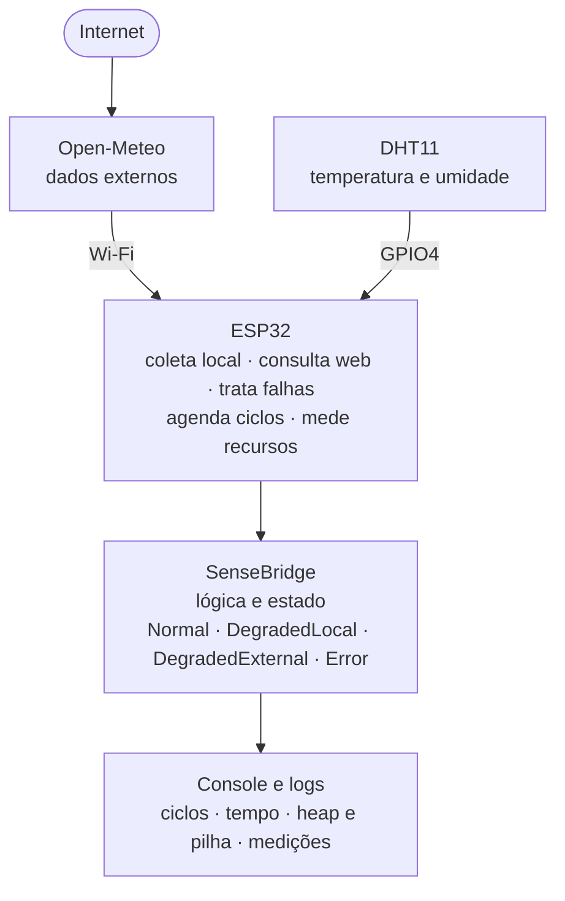
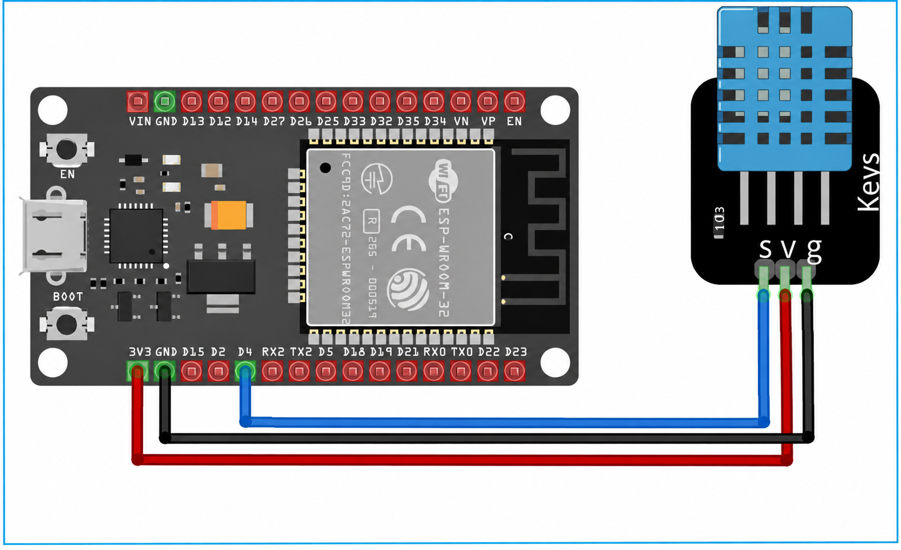

# SenseBridge

[](https://github.com/msc-sed-ufrr/SenseBridge/actions/workflows/ci.yml)

**SenseBridge** é uma biblioteca de software embarcado desenvolvida em **Rust** para integração resiliente de dados ambientais em sistemas baseados em **ESP32**.

O projeto é desenvolvido no contexto da disciplina de **Arquitetura e Organização de Computadores**, do Mestrado Profissional em Computação Aplicada da Universidade Federal de Roraima — PPCA/UFRR, na trilha PTT4 — Biblioteca de software embarcado.

## Objetivo

Desenvolver e validar uma biblioteca embarcada capaz de integrar dados ambientais provenientes de uma fonte local e de uma fonte externa, mantendo comportamento definido diante de falhas de leitura ou indisponibilidade das fontes.

A implementação de referência utiliza:

- ESP32;
- sensor DHT11 para temperatura e umidade;
- API Open-Meteo como fonte externa de dados meteorológicos;
- linguagem Rust.

## O que a biblioteca faz

A cada ciclo, a biblioteca `sense_bridge`:

- obtém a leitura da fonte local e a da fonte externa, por meio de traits implementadas pela plataforma;
- valida os valores recebidos e impede que um valor inválido apareça como válido;
- identifica a origem de cada valor e, quando uma fonte falha, o tipo da falha;
- opera de forma degradada quando apenas uma fonte está disponível;
- sinaliza explicitamente o estado de erro quando as duas fontes estão indisponíveis;
- retorna à operação normal no primeiro ciclo em que as duas fontes voltam.

Opcionalmente, o `FreezeDetector` marca como suspeita uma leitura local repetida por muitos ciclos, sem mudar o estado: a validação de faixa não detecta um sensor travado em um valor plausível. O firmware pode também reiniciar o sensor por suspeita, no máximo uma vez por limiar. A lacuna foi apontada pela validação do laboratório SENTINELA (UFRR/PPCA); o detector foi acrescentado depois da v0.1.0 e ainda não foi avaliado em hardware.

A biblioteca é `no_std`, não aloca memória e não tem dependências. O uso da API está no [README da crate](sense-bridge/README.md).

## Resultados

| Cenário | DHT11 | Open-Meteo | Estado esperado | Resultado no ESP32 (5 repetições de 10 ciclos) |
| --- | --- | --- | --- | --- |
| C1 — Operação normal | Disponível | Disponível | `Normal` | 50/50 ciclos em `Normal` |
| C2 — Falha local | Indisponível | Disponível | `DegradedLocal` | 50/50 ciclos em `DegradedLocal` |
| C3 — Falha externa | Disponível | Indisponível | `DegradedExternal` | 50/50 ciclos em `DegradedExternal` |
| C4 — Falha simultânea | Indisponível | Indisponível | `Error` | 50/50 ciclos em `Error` |
| C5 — Recuperação | Recuperado | Disponível | Retorno a `Normal` | 5/5 recuperações no primeiro ciclo com as duas fontes válidas |
| C5 — Recuperação da fonte externa (complementar, 25/11/2026) | Disponível | Recuperado | Retorno a `Normal` | 5/5 recuperações no primeiro ciclo depois de a placa obter IP |

- **Testes automatizados:** 62 na versão avaliada (84 hoje, com o detector de leitura congelada, o cenário C6 e a tabela de RAM do console, acrescentados depois), executados sem hardware, cobrindo C1–C5, validação, transições e a interpretação de respostas reais da Open-Meteo.
- **Latência:** ciclos sem consulta externa entre 18 e 22 ms.
- **Memória:** cerca de 23,5 KiB de Flash e 13,4 KiB de RAM estática a mais que um firmware-base equivalente sem a biblioteca.

As capturas oficiais de C1–C5 foram feitas com o firmware de `3725e20`, que lê o DHT11 com a crate `dht-sensor`; a lógica da biblioteca nesse firmware é a mesma da `sense_bridge` 0.1.0. Em 25/11/2026, em resposta à revisão por pares, C1 foi repetido com o firmware atual (`dht11-trace`), com o mesmo tempo de leitura, e C5 foi executado com a falha na rede ([C1](docs/memory/2026-11-25-c1-firmware-atual.md), [C5](docs/memory/2026-11-25-c5-externa.md)). A metodologia e os números completos estão na [avaliação experimental](docs/memory/2026-10-24-avaliacao-experimental.md). O projeto não inclui medição de consumo energético.

## Arquitetura



Componentes, fluxo do ciclo, princípios e decisões de arquitetura estão em [docs/knowledge/architecture.md](docs/knowledge/architecture.md).

## Estrutura

```text
SenseBridge/
├── Cargo.toml          # workspace: biblioteca e ferramentas de host
├── sense-bridge/       # biblioteca (no_std, independente de hardware), publicada no crates.io
│   ├── src/
│   ├── tests/          # cenários C1–C5 com fontes simuladas e respostas gravadas da Open-Meteo
│   ├── examples/
│   ├── CHANGELOG.md
│   └── README.md       # documentação da crate
├── tools/
│   └── console/        # console de host: acompanha os ciclos pela serial e grava as capturas
├── firmware/           # casos de uso, um projeto por placa (não publicados)
│   └── esp32/          # DHT11 + Open-Meteo
├── docs/               # projeto de pesquisa, produto e arquitetura (knowledge/), histórico e decisões (memory/), avaliação, relatório e evidências
├── scripts/
│   └── evidencias.sh   # gera docs/evidencias/verificacao.md
├── capturas/           # capturas de trabalho gravadas pelo console (ignoradas pelo git)
├── .github/workflows/  # CI: formatação, clippy, testes, documentação e pacote
├── README.md           # este arquivo: o projeto de pesquisa
├── LICENSE-APACHE
└── LICENSE-MIT
```

## Como reproduzir

### 1. Testes sem hardware

Requer apenas o Rust, instalado pelo [rustup](https://rustup.rs) (versão 1.85 ou mais recente). Na raiz do repositório:

```sh
cargo test                                     # 84 testes da biblioteca e do console, com C1–C6
cargo clippy --all-targets -- -D warnings      # análise estática
cargo run -p sense_bridge --example simulate   # imprime os cenários simulados em CSV
scripts/evidencias.sh                          # registra tudo em docs/evidencias/verificacao.md
```

### 2. Firmware no ESP32

**Hardware:** ESP32 DevKit (ESP32-WROOM-32), módulo DHT11, jumpers, cabo USB e uma rede Wi-Fi de 2,4 GHz.

| DHT11 | ESP32 |
| --- | --- |
| S (DATA) | GPIO4 (D4) |
| V (VCC) | 3V3 |
| G (GND) | GND |



O módulo de 3 pinos já tem o resistor de pull-up. Com o sensor de 4 pinos, sem placa, coloque um resistor de 4,7–10 kΩ entre DATA e 3V3.

**Ferramentas**, uma vez por máquina:

```sh
cargo install espup espflash ldproxy --locked
espup install --targets esp32
```

**Configuração, compilação e gravação**, em `firmware/esp32/`:

```sh
. ~/export-esp.sh                # em cada terminal novo
cp cfg.toml.example cfg.toml     # preencha wifi_ssid e wifi_password
cargo run --release              # compila, grava e abre o monitor serial
```

O primeiro build baixa o ESP-IDF v5.5.5, o que leva alguns minutos. Pinos alternativos, alimentação do DHT11 por GPIO e o formato da saída estão no [README do firmware](firmware/esp32/README.md).

### 3. Cenários C1–C5 no ESP32

Com o firmware gravado, o console do host acompanha os ciclos e grava a captura. Da raiz do repositório, em outro terminal:

```sh
espflash monitor --non-interactive | cargo run -q -p sense_bridge_console -- --out capturas/c2-r1
```

O protocolo usa 5 repetições de 10 ciclos por cenário, com ciclo de 5 s (`cycle_interval_ms = 5000`) e tempo limite HTTP de 3 s. Em C3, C4 e C5, `external_refresh_ms = 5000` faz a fonte externa ser consultada aproximadamente a cada ciclo; nos demais, vale o padrão de 15 minutos. Alterações em `cfg.toml` exigem gravar o firmware de novo. Antes de uma captura oficial, rode `cargo clean --release -p esp-idf-sys` em `firmware/esp32/` e compile de novo: sem isso, o `App version` do boot pode ficar preso a um commit antigo ([lições](docs/memory/lessons.md)).

| Cenário | Como induzir | Esperado |
| --- | --- | --- |
| C1 | Nenhuma falha | Todos os ciclos em `Normal` |
| C2 | Desconectar a alimentação e o DATA do DHT11 | `DegradedLocal`, com falha local `NoResponse` |
| C3 | `wifi_ssid` de uma rede inexistente em `cfg.toml` | `DegradedExternal`, com falha externa `NoConnectivity` |
| C4 | C2 e C3 ao mesmo tempo | `Error` |
| C5 | Iniciar com o DHT11 desconectado e religá-lo depois do ciclo 2 | Transição para `Normal`, marcada como recuperação, no primeiro ciclo com as duas fontes válidas |

O console mostra o estado de cada ciclo e, ao final, um resumo com a contagem por estado e por tipo de falha. Uma captura gravada pode ser revista com `cargo run -q -p sense_bridge_console -- --no-save < capturas/c2-r1.txt`, e `cargo run -q -p sense_bridge_console -- --analyze capturas/c*.csv` confere cada captura com o estado esperado no seu cenário, identificado pelo nome do arquivo. O cenário C6, leitura congelada por injeção de falha, tem a configuração no [README do firmware](firmware/esp32/README.md#cenário-c6-leitura-congelada-por-injeção-de-falha). Para calibrar o limiar de `local_frozen_after`, `cargo run -q -p sense_bridge_console -- --repeats capturas/*.csv` mede a maior sequência de leituras locais iguais em capturas de qualquer nome. As capturas oficiais ficam em [docs/evidencias](docs/evidencias/README.md).

### Versões verificadas

Em 21/10/2026, com macOS em Apple Silicon:

| Ferramenta | Versão |
| --- | --- |
| Rust (biblioteca e console) | 1.97.1; a crate declara `rust-version = 1.85`, verificada na CI |
| Toolchain `esp` (firmware) | 1.97.0.0, instalada pelo espup 0.17.1 |
| ESP-IDF | v5.5.5 (fixado em `firmware/esp32/.cargo/config.toml`) |
| espflash | 4.6.0 |

## Documentação

| Documento | Conteúdo |
| --- | --- |
| [Projeto de pesquisa](docs/memory/2026-09-17-projeto-de-pesquisa-ptt4.pdf) | Proposta aprovada: problema, objetivos, escopo e entregáveis |
| [Produto](docs/knowledge/product.md) | Propósito, regras de negócio com o motivo, casos de uso e perguntas em aberto |
| [Arquitetura](docs/knowledge/architecture.md) | Componentes, fluxo do ciclo, stack e invariantes |
| [Decisões](docs/memory/decisions/) | ADR-001 a ADR-011, uma por arquivo |
| [Avaliação experimental](docs/memory/2026-10-24-avaliacao-experimental.md) | Protocolo e resultados de C1–C5, latência, Flash e RAM |
| [Relatório técnico entregue](docs/memory/2026-11-03-entrega-final-ptt4.pdf) | Versão entregue em 03/11/2026 ([DOCX](docs/memory/2026-11-03-entrega-final-ptt4.docx)). O [Markdown de 28/10](docs/memory/2026-10-28-relatorio-tecnico.md) é uma versão anterior; onde os dois divergem, vale o entregue |
| [Adendo ao relatório](docs/memory/2026-11-25-adendo-relatorio-tecnico.md) | Resposta à revisão por pares de 24/11/2026: origem dos dados, medições complementares, errata e limitações ([PDF](docs/memory/2026-11-25-adendo-relatorio-tecnico.pdf)) |
| [Revisão por pares (S14)](docs/memory/2026-11-25-revisao-por-pares-s14.md) | Os achados das duas duplas revisoras e a conferência de cada um |
| [Publicação de uma versão](docs/knowledge/release.md) | Passo a passo para publicar a crate; o registro da 0.1.0 está em [docs/memory](docs/memory/2026-10-28-publicacao-sense-bridge-0.1.0.md) |
| [Vídeo de demonstração](https://drive.google.com/file/d/1QOOm1pnZYE3JukNmh4Nho3RAdCsDEtb8/view) | Demonstração do projeto pedida pelo projeto de pesquisa (§10.1), hospedada no Google Drive |
| [Evidências](docs/evidencias/README.md) | Verificação do código, capturas oficiais dos experimentos e medições complementares |

## Tecnologias

- Rust
- ESP32
- DHT11
- Open-Meteo
- VS Code
- Git
- GitHub

## Autores

- Ezequias Carlos Ferreira da Silva
- Marcelo Gomes Barbosa

## Orientador

Prof. Herbert Oliveira Rocha

## Instituição

Universidade Federal de Roraima — UFRR  
Programa de Pós-Graduação em Computação Aplicada — PPCA  
Linha de Sistemas Embarcados e Distribuídos — SED

## Status

Implementação, avaliação experimental e versionamento das capturas oficiais concluídos. Relatório técnico entregue em 03/11/2026; a revisão por pares de 24/11/2026 foi respondida com medições complementares e um adendo ao relatório. O [vídeo de demonstração](https://drive.google.com/file/d/1QOOm1pnZYE3JukNmh4Nho3RAdCsDEtb8/view) acompanha a entrega.

**Entrega prevista:** 26 de novembro de 2026.

## Licença

Este projeto é licenciado sob a [Licença Apache 2.0](LICENSE-APACHE) ou a [Licença MIT](LICENSE-MIT), à escolha de quem o utiliza.
