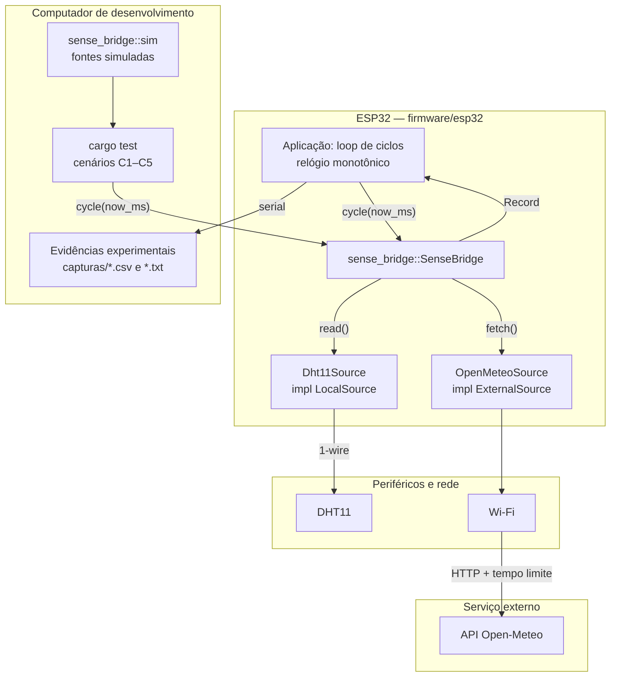
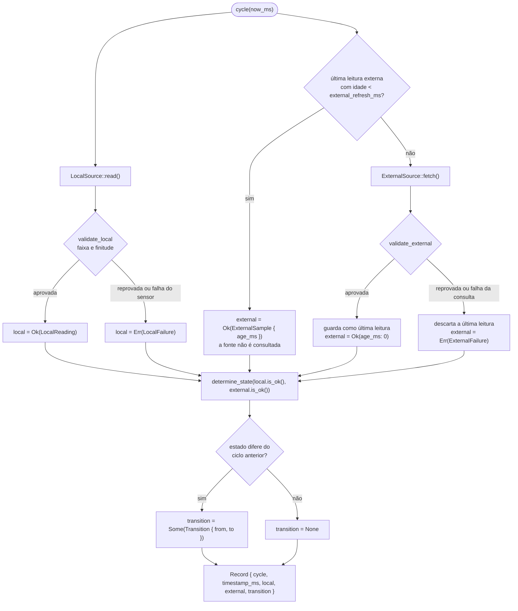

# Arquitetura e Princípios

> **Atualizado em:** 21/10/2026 · **Base:** código em `sense-bridge/`, `firmware/esp32/`, `tools/console/`, [PRD](01-prd.md) e documentos de `docs/`.

Para contexto de produto, personas, regras de negócio e casos de uso, ver [docs/01-prd.md](01-prd.md). Este documento cobre o desenho do sistema: componentes, fluxo de dados, módulos, stack, observabilidade, princípios e decisões de arquitetura.

---

## 1. Componentes

O repositório separa **a biblioteca** (independente de hardware), as **ferramentas de host** e o **firmware da placa**. O workspace da raiz contém a crate `sense_bridge` e ferramentas de desenvolvimento como `sense_bridge_console`; `firmware/esp32/` permanece separado da execução normal dos testes de host por exigir toolchain e alvo específicos do ESP32.

| Unidade | Runtime / alvo | Responsabilidade |
| --- | --- | --- |
| `sense-bridge/` (crate `sense_bridge`) | Rust 2024, sem dependências, host e alvo embarcado | Núcleo: modelo de leituras e falhas, validação, ciclo de aquisição, estados de operação e registro integrado |
| `sense_bridge::sim` | idem | Fontes simuladas com resultado ajustável entre ciclos; permite reproduzir falha e recuperação sem hardware |
| `sense-bridge/tests/scenarios.rs` | host | Cenários C1–C5, limites de validação, transições e intervalo de consulta externa |
| `sense-bridge/examples/simulate.rs` | host | Percorre C1–C5 com fontes simuladas e imprime um registro por ciclo em CSV |
| `tools/console/` (crate `sense_bridge_console`) | host | Captura a saída serial do ESP32, acompanha os ciclos e grava evidências em TXT/CSV |
| `firmware/esp32/` (bin `sense_bridge_esp32`, `publish = false`) | Rust + Xtensa + ESP-IDF/`esp-idf-svc` | Caso de uso: driver do DHT11, Wi-Fi, cliente Open-Meteo com tempo limite, relógio monotônico, cadência dos ciclos, instrumentação e saída CSV |
| DHT11 | periférico | Fonte local de temperatura e umidade |
| Open-Meteo | serviço HTTP externo | Fonte externa de contexto (nunca referência de verdade para o DHT11) |

Cada placa futura entra como projeto irmão em `firmware/`, com a sua própria toolchain, consumindo a mesma crate.

> **Estado da implementação em 04/10/2026.** A crate declara `#![no_std]`, o README participa dos doctests e o núcleo pode ser verificado no host sem hardware. A suíte completa possui **53 testes aprovados**: 18 unitários, 7 da integração Open-Meteo, 12 de cenários, 14 do console e 2 doctests. O firmware ESP32 está funcional, conecta-se ao Wi-Fi, consulta a Open-Meteo, executa o `SenseBridge`, mede latência e memória e produz registros experimentais. A integração real do DHT11 está concluída e validada. Um shield ESP-01S DHT11 v1.0 usado posteriormente em outra montagem não respondeu à leitura, sendo tratado apenas como ocorrência específica de hardware e não como pendência arquitetural.

---

## 2. Fluxo de dados

### Topologia



A biblioteca é o único ponto que combina as duas fontes, e conhece cada uma apenas pela sua trait. Driver, pilha de rede, relógio e serialização ficam do lado do firmware.

### Ciclo de aquisição



### Caminho de um ciclo

1. A aplicação chama `cycle(now_ms)` com o instante de um relógio monotônico. A cadência e o intervalo mínimo de amostragem do DHT11 são responsabilidade dela.
2. `LocalSource::read()` devolve a leitura ou uma `LocalFailure` de tipo identificado (`NoResponse`, `Checksum`).
3. `validate_local` aplica `Limits` — faixa com limites inclusivos e rejeição de NaN/infinito — e converte a reprovação em `LocalFailure::Invalid(InvalidReason)`.
4. Se existe leitura externa guardada com idade menor que `external_refresh_ms`, ela é reutilizada e o registro informa `age_ms`; a fonte externa não é consultada nesse ciclo.
5. Caso contrário, `ExternalSource::fetch()` é chamado. O tempo limite é aplicado pela implementação, que devolve `ExternalFailure::Timeout` ao excedê-lo; a resposta passa por `validate_external`.
6. Qualquer falha na consulta ou na validação externa **descarta** a leitura guardada, de modo que um valor obtido antes da falha nunca volta a aparecer como atual.
7. `determine_state` deriva o estado da disponibilidade das duas fontes naquele ciclo (`Normal`, `DegradedLocal`, `DegradedExternal`, `Error`).
8. Se o estado difere do ciclo anterior, o registro carrega um `Transition`; `is_recovery()` identifica o retorno a `Normal`. No primeiro ciclo não há transição, porque nenhum estado é presumido antes dele.
9. O `Record` é devolvido com identificador sequencial de ciclo, instante, resultado de cada fonte e a transição. O firmware o serializa em CSV para os experimentos.

---

## 3. Módulos do domínio

| Módulo | Tipos principais | Papel |
| --- | --- | --- |
| `bridge` | `SenseBridge<L, E>`, `Config` | Orquestra o ciclo: aquisição, validação, reuso da leitura externa, estado, transição e montagem do registro. Única parte com memória entre ciclos |
| `source` | `LocalSource`, `ExternalSource` | Fronteira com hardware e rede. É por onde — e só por onde — a plataforma entra na biblioteca |
| `reading` | `LocalReading`, `ExternalReading`, `LocalFailure`, `ExternalFailure`, `InvalidReason` | Modelo de dados e taxonomia de falhas, separada por fonte: o tipo de falha local não é expressável na externa e vice-versa |
| `validation` | `Range`, `Limits`, `validate_local`, `validate_external` | Faixas com limites inclusivos e rejeição de valores não numéricos. `Limits::DHT11` e `Limits::PLAUSIBLE` seguem as faixas fechadas em D3 e D4 (PRD) |
| `state` | `OperationState`, `Transition`, `determine_state` | Estado derivado da disponibilidade e detecção de transição e recuperação. Função pura, sem memória |
| `record` | `Record`, `ExternalSample` | Saída de um ciclo: origem, validade, motivo da falha, idade da leitura externa e transição |
| `sim` | `Simulated<T, F>`, `SimulatedLocal`, `SimulatedExternal` | Fontes controláveis entre ciclos, com contagem de consultas, para testes e exemplos no host |

O estado retido em `SenseBridge` é deliberadamente mínimo: `next_cycle` (identificador sequencial), `state` (estado do ciclo anterior, para a transição) e `last_external` (última leitura externa válida e o instante em que foi obtida, para o reuso dentro do intervalo).

---

## 4. Observabilidade

A biblioteca não registra log, não aloca e não imprime: **o próprio `Record` é a telemetria**. Cada ciclo produz exatamente um registro, inclusive no estado `Error`, com identificador de ciclo, instante, resultado por fonte, idade da leitura externa e a transição — o suficiente para reconstruir o comportamento sem inspecionar o código.

Como `timestamp_ms` é fornecido pelo chamador e a biblioteca não lê relógio, toda medição de tempo acontece fora dela, sem contaminar o trecho medido.

| Sinal | Onde é coletado | Situação |
| --- | --- | --- |
| Registros e transições | `Record` devolvido por `cycle` | Implementado |
| Latência por operação e ciclo | Firmware, com `read_us`, `fetch_us` e `cycle_us` | Implementado |
| RAM em execução | Firmware: heap livre, menor heap livre e margem de stack | Implementado e medido |
| Flash | Tamanho do firmware final via `xtensa-esp32-elf-size`, comparado ao firmware-base sem a biblioteca (D8) | Firmware completo e firmware-base medidos ([avaliação experimental](03-avaliacao-experimental.md)) |
| Exportação | Serial processada por `sense_bridge_console`, com gravação em TXT/CSV | Implementado; faltam apenas algumas colunas do protocolo experimental final, como repetição e estado esperado |

Para não distorcer o que se quer medir, as amostras de latência são acumuladas em memória e exportadas fora da janela medida, e o custo da própria instrumentação é quantificado à parte (risco previsto no PRD).

---

## 5. Stack

### Linguagem e ferramentas

| Camada | Linguagem | Versão |
| --- | --- | --- |
| Biblioteca | Rust (edition 2024) | `rust-version = 1.85`; verificada em 1.97.1 |
| Firmware ESP32 | Rust + ESP-IDF | Rust ESP 1.90.0.0; ESP-IDF v5.5.5; alvo Xtensa ESP32 |

### `sense-bridge/` (crate `sense_bridge`)

- **Sem dependências.** `[dependencies]` está vazio e assim deve permanecer: cada crate a mais é código que precisa compilar para o alvo embarcado e entra na conta de Flash do experimento.
- **Traits genéricas em vez de `dyn`.** `SenseBridge<L, E>` é monomorfizado, sem vtable nem ponteiro gordo no caminho do ciclo.
- **Tipos `Copy`, sem alocação.** `Record`, leituras e falhas são valores pequenos copiáveis; nada é movido para heap nem exige `alloc`.
- **`f32` para temperatura e umidade.** Precisão suficiente para as grandezas envolvidas e mais barata que `f64` no ESP32; a finitude é checada na validação.
- **`Result` por fonte.** A indisponibilidade de uma fonte é representada no tipo, não por sentinela ou flag paralela.

### `firmware/esp32/`

O firmware de referência está implementado sobre ESP-IDF/`esp-idf-svc`, com suporte a `std`, Wi-Fi, TLS/HTTP e integração com a biblioteca por dependência de caminho.

Responsabilidades do firmware:

- configurar e executar o ESP32;
- implementar a fonte local DHT11 por meio de biblioteca existente;
- estabelecer a conexão Wi-Fi;
- consultar a Open-Meteo com tempo limite configurável;
- fornecer o relógio monotônico e a cadência dos ciclos;
- executar `SenseBridge::cycle`;
- coletar latência, heap e stack;
- emitir os registros pela serial para captura pelo `sense_bridge_console`.

A interpretação da resposta da Open-Meteo permanece testável no host por meio de respostas gravadas.

### Dados

Não há banco nem persistência de longo prazo no dispositivo. O estado vive em memória durante a execução (`Option<OperationState>` e `Option<(ExternalReading, u64)>`). As evidências experimentais são capturadas no computador de apoio e armazenadas em `capturas/`, em formatos CSV e TXT.

### Convenções

- A API pública é o que `lib.rs` reexporta; o resto é detalhe de implementação, mesmo em módulo público.
- Tempo em milissegundos (`u64`) de relógio monotônico, sempre fornecido pelo chamador; diferenças com `saturating_sub`.
- Faixas são intervalos fechados: o valor exatamente no limite é válido.
- Identificador de ciclo começa em 0 e só cresce.
- Documentação e comentários em português; nomes de código em inglês.
- Testes unitários junto do módulo (`#[cfg(test)]`); cenários do protocolo em `tests/scenarios.rs`, nomeados pelo comportamento verificado.
- Clippy sem avisos, com avisos tratados como erro.

---

## 6. Princípios de arquitetura

- **O hardware fica fora da biblioteca.** Toda E/S entra por `LocalSource` e `ExternalSource`. Nenhum módulo da crate pode passar a depender de HAL, pilha de rede, relógio, alocador ou `std`: o que a plataforma oferece entra por parâmetro ou por trait, ou não entra.
- **Falha é um valor, não um efeito colateral.** Cada fonte aparece no registro como `Result` com o tipo de falha identificado. A biblioteca não entra em pânico, não reinicia o dispositivo e não interrompe os ciclos seguintes — nem no estado `Error`.
- **Nada inválido atravessa a fronteira como válido.** A validação acontece antes de qualquer valor chegar ao `Record`; `Ok` existe apenas para leitura aprovada. Um caminho novo que monte um registro sem passar pela validação viola o critério de sucesso central do projeto.
- **As fontes não se misturam.** Não há média, substituição nem correção de uma fonte pela outra. A divergência entre DHT11 e Open-Meteo não altera a validade de nenhuma leitura nem o estado: a fonte externa é contexto, não referência de verdade.
- **O estado é derivado, não acumulado.** `determine_state` é função pura da disponibilidade no ciclo. A única memória entre ciclos é o estado anterior (para emitir a transição) e a última leitura externa válida (para o reuso) — qualquer outra memória deve ser justificada, porque cria caminhos que os testes de cenário não cobrem.
- **A falha invalida o que estava guardado.** Toda falha na fonte externa descarta a leitura em cache. Nenhum valor anterior à última falha identificada pode reaparecer como atual, mesmo que ainda esteja dentro do intervalo de consulta.
- **O chamador é dono do tempo.** A biblioteca não dorme, não agenda e não lê relógio. Cadência do ciclo, intervalo mínimo do sensor e tempo limite da consulta são do firmware, o que mantém a medição de latência fora do trecho medido.
- **O núcleo é verificável sem hardware.** Todo comportamento novo do núcleo precisa ser demonstrável no host com `sim` e respostas gravadas. O que só puder ser exercitado no ESP32 pertence ao firmware, não à crate.

---

## 7. Diretrizes de desenvolvimento

Convenções de Git e fluxo de contribuição estão em [`AGENTS.md`](../AGENTS.md) — GitFlow, commits focados e verificação da árvore de trabalho após cada operação. A estrutura do repositório e as instruções de execução estão no [README do projeto](../README.md); o uso da API, no [README da crate](../sense-bridge/README.md).

Na raiz, sem hardware:

```sh
cargo test                                     # testes unitários e cenários C1–C5
cargo clippy --all-targets -- -D warnings      # análise estática
cargo run -p sense_bridge --example simulate   # imprime os cenários em CSV
```

Os firmwares compilam com a toolchain da sua placa, dentro de `firmware/<placa>/`.

---

## 8. Decisões de arquitetura

### ADR-001 — Fontes como traits, núcleo sem hardware

**Status:** aceita  
**Contexto:** A biblioteca precisa rodar no ESP32 com DHT11 e Open-Meteo, mas o núcleo tem de ser verificável no computador de desenvolvimento, sem sensor e sem rede, e reutilizável em outras placas.  
**Decisão:** O núcleo define `LocalSource` e `ExternalSource` e não conhece nenhum periférico. Driver, pilha de rede e tempo limite ficam nas implementações, no firmware.  
**Justificativa:** Inverter a dependência move toda a parte não determinística para fora do código que se quer testar. Com genéricos em vez de `dyn`, o custo em tempo de execução é nulo.  
**Consequências:** A crate não compila sozinha nada que leia o mundo real — é preciso um firmware. Em troca, os cenários C1–C5 rodam no host com `sim`, e outra placa reaproveita o núcleo implementando duas traits.

### ADR-002 — Sem `std`, sem alocação e sem dependências

**Status:** aceita e implementada  
**Contexto:** O alvo tem RAM e Flash restritas, e o projeto mede o custo próprio da biblioteca. Cada dependência transitiva entra nessa conta e precisa compilar para o alvo.  
**Decisão:** A crate não usa `std`, não aloca e não declara dependências. Tudo que ela produz cabe em tipos `Copy` de tamanho conhecido.  
**Justificativa:** Sem alocador, não há falha de alocação nem fragmentação a tratar em tempo de execução, e a medição de Flash atribuída à biblioteca fica interpretável.  
**Consequências:** Nada de `String`, `Vec` ou formatação dentro da crate — a serialização permanece fora do núcleo. `lib.rs` declara `#![no_std]` e o README é verificado por doctests, de modo que essa restrição deixou de ser apenas uma convenção documental.

### ADR-003 — O instante do ciclo é injetado pelo chamador

**Status:** aceita  
**Contexto:** A biblioteca precisa datar registros, medir a idade da leitura externa e decidir sobre o intervalo de consulta, mas não deve depender de temporizador nem interferir na latência medida.  
**Decisão:** `cycle(now_ms)` recebe o instante de um relógio monotônico. A biblioteca não lê relógio, não dorme e não agenda.  
**Justificativa:** Tempo injetado torna o comportamento determinístico e testável (reuso da leitura externa e expiração são testados sem esperar). A instrumentação de latência fica no firmware, fora do trecho medido.  
**Consequências:** Respeitar o intervalo mínimo do DHT11 e a cadência do ciclo passa a ser obrigação do firmware. Diferenças usam `saturating_sub`, de modo que um relógio que retroceda não produz idade negativa — mas a biblioteca não detecta esse retrocesso.

### ADR-004 — Recuperação é evento de transição, e a reação é no próprio ciclo

**Status:** aceita (PRD, D1 e D2, fechadas)  
**Contexto:** Recuperação poderia ser um quinto estado da máquina, e falha/recuperação poderiam exigir N ciclos consecutivos (histerese) para serem declaradas.  
**Decisão:** Quatro estados apenas. A recuperação é o `Transition` cujo destino é `Normal` (`is_recovery()`), e a reação acontece no próprio ciclo, sem histerese.  
**Justificativa:** Manter o estado como função da disponibilidade do ciclo torna a tabela de estados verificável linha a linha e sustenta o critério "recuperação em 1 ciclo" de C5. Histerese acrescentaria memória e atrasaria a detecção que o experimento quer medir.  
**Consequências:** Falhas intermitentes do DHT11 produzem oscilação de estado entre ciclos; isso é observável no CSV e será relatado como taxa de falhas espontâneas. Introduzir histerese depois muda o resultado esperado de C2–C5.

### ADR-005 — Uma falha externa descarta a leitura reutilizada

**Status:** aceita  
**Contexto:** Entre duas consultas, a última leitura externa válida é reutilizada com a idade informada. Quando a consulta seguinte falha, seria possível continuar servindo esse valor até o fim do intervalo.  
**Decisão:** Toda falha de consulta ou de validação externa apaga a leitura guardada e a fonte fica indisponível até uma nova consulta bem-sucedida.  
**Justificativa:** Um valor anterior à falha apresentado como atual é exatamente o tipo de propagação silenciosa que o projeto existe para evitar.  
**Consequências:** C3 entra em degradado já no ciclo da falha. Em compensação, uma queda ocorrida durante o período de reuso só é percebida na consulta seguinte — com o intervalo de 15 minutos fechado em D5a, esse atraso é significativo. A D10 manteve a arquitetura: nos experimentos C3–C5, `external_refresh_ms = 5000` faz a fonte externa ser consultada aproximadamente a cada ciclo.

### ADR-006 — Um `Result` por fonte no registro, sem fusão

**Status:** aceita  
**Contexto:** O registro poderia carregar valores fundidos (média, substituição) ou campos opcionais acompanhados de flags de validade.  
**Decisão:** `Record` guarda `Result<LocalReading, LocalFailure>` e `Result<ExternalSample, ExternalFailure>`, com taxonomias de falha distintas por fonte e nenhuma combinação numérica.  
**Justificativa:** O tipo torna impossível apresentar um valor sem origem ou sem validade, e impede que um estado inconsistente (valor presente com flag de inválido) seja representável. Taxonomias separadas evitam falhas de rede em leitura local.  
**Consequências:** A aplicação sempre trata as duas fontes explicitamente — não existe "o valor" do ciclo. O estado é derivado desses dois `Result` e nunca precisa ser armazenado no registro.

### ADR-007 — Firmware fora do workspace, um projeto por placa

**Status:** aceita  
**Contexto:** Cada placa exige toolchain e alvo próprios. Se o firmware fizesse parte do workspace, `cargo test` na raiz tentaria compilá-lo para o host.  
**Decisão:** O workspace de host contém a biblioteca e ferramentas auxiliares, como `tools/console/`. O firmware permanece isolado em `firmware/`, com um projeto por placa, `publish = false` e dependência da crate por caminho.  
**Justificativa:** Mantém os comandos da raiz rodando sem hardware e o caso de uso fora do que vai para o crates.io.  
**Consequências:** O núcleo e as ferramentas de host são testados sem depender do ESP32. O firmware possui configuração e build próprios e deve ser compilado e gravado explicitamente com a toolchain ESP.

### Decisões de projeto do PRD

Todas as [decisões de projeto (PRD, §12)](01-prd.md#12-decisões-de-projeto) estão fechadas: recuperação como evento de transição (D1), ausência de histerese (D2), faixas do DHT11 (D3) e da fonte externa (D4), intervalo externo de 15 min (D5a), ciclo local de 5 s (D5b), timeout HTTP de 3 s (D5c), coordenadas configuráveis (D6), 5 repetições de 10 ciclos por cenário (D7), referência dupla para RAM e Flash (D8), licença dupla (D9), arquitetura mantida diante do atraso de identificação durante a reutilização (D10), nova tentativa a cada ciclo (D11) e uso de ESP-IDF/`esp-idf-svc` no ESP32 (D12).
