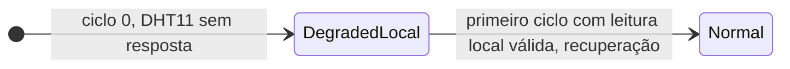

# Avaliação Experimental do SenseBridge

> **Atualizado em:** 24/10/2026

## 1. Objetivo

A avaliação experimental do SenseBridge teve como objetivo verificar:

- o comportamento da biblioteca diante da disponibilidade e indisponibilidade das fontes de dados;
- as transições entre os estados operacionais;
- a recuperação após falhas;
- a integração com a fonte externa Open-Meteo;
- a latência de execução;
- o tamanho do firmware;
- o uso de memória no ESP32.

Foram considerados os cenários experimentais C1 a C5 e a comparação de memória prevista na decisão D8 do PRD.

---

## 2. Protocolo experimental final C1–C5

O protocolo físico final utilizou:

- 5 repetições por cenário;
- 10 ciclos por repetição;
- 50 ciclos por cenário;
- 250 ciclos oficiais no total;
- intervalo entre ciclos de 5 s;
- timeout HTTP de 3 s.

Para C3, C4 e C5, o intervalo de atualização externa foi temporariamente reduzido para:

```text
external_refresh_ms = 5000
```

Isso permitiu verificar a disponibilidade da fonte externa aproximadamente a cada ciclo durante a indução controlada de falhas. A configuração normal permanece em 900000 ms (15 min).

| Cenário | Condição experimental | Estado esperado | Resultado físico final |
|---|---|---|---|
| C1 | DHT11 e Open-Meteo disponíveis | `Normal` | **Aprovado — 5/5; 50/50 ciclos** |
| C2 | Fonte local indisponível | `DegradedLocal` | **Aprovado — 5/5; 50/50 ciclos** |
| C3 | Fonte externa indisponível | `DegradedExternal` | **Aprovado — 5/5; 50/50 ciclos** |
| C4 | Duas fontes indisponíveis | `Error` | **Aprovado — 5/5; 50/50 ciclos** |
| C5 | Fonte local falha e depois volta a responder, com fonte externa válida | retorno para `Normal` | **Aprovado — 5/5 recuperações** |

### 2.1 C1 — Operação normal

DHT11 e Open-Meteo permaneceram disponíveis.

Resultado final:

```text
50/50 ciclos em Normal
```

As leituras locais observadas ficaram em torno de 29–31 °C e 29–32 %UR. A fonte externa permaneceu válida em todas as repetições.

Após a primeira consulta HTTP de cada execução, os ciclos sem nova consulta externa ficaram tipicamente em aproximadamente 21–22 ms.

### 2.2 C2 — Falha da fonte local

A falha foi produzida fisicamente retirando alimentação e sinal do DHT11, enquanto a conectividade externa permaneceu disponível.

Resultado final:

```text
50/50 ciclos em DegradedLocal
50/50 falhas locais = NoResponse
```

A Open-Meteo permaneceu válida, demonstrando que a indisponibilidade da fonte local não interrompe a operação do sistema.

Os ciclos em regime estável ficaram tipicamente em aproximadamente 18–19 ms.

### 2.3 C3 — Falha da fonte externa

O DHT11 permaneceu funcional. Para produzir uma condição externa reproduzível, o firmware foi configurado temporariamente para tentar associar-se a uma rede Wi-Fi inexistente.

Resultado final:

```text
50/50 ciclos em DegradedExternal
50/50 falhas externas = NoConnectivity
```

O DHT11 continuou fornecendo leituras válidas durante toda a falha externa.

Os ciclos observados nessa condição ficaram tipicamente em aproximadamente 22 ms.

### 2.4 C4 — Falha simultânea

Foram combinadas as condições de C2 e C3:

- DHT11 indisponível;
- Wi-Fi externo indisponível.

Resultado final:

```text
50/50 ciclos em Error
50/50 falhas locais = NoResponse
50/50 falhas externas = NoConnectivity
```

Mesmo em `Error`, o firmware continuou executando novos ciclos e novas tentativas.

Os ciclos ficaram tipicamente em aproximadamente 18 ms.

### 2.5 C5 — Recuperação

Em cada repetição, a fonte local permaneceu indisponível nos ciclos iniciais. Após o ciclo 2, o DHT11 foi novamente energizado.

Resultados oficiais:

| Repetição | Falha inicial | Primeiro ciclo em `Normal` | Resultado |
|---|---|---:|---|
| 1 | `DegradedLocal` | 3 | Aprovado |
| 2 | `DegradedLocal` | 3 | Aprovado |
| 3 | `DegradedLocal` | 4 | Aprovado |
| 4 | `DegradedLocal` | 3 | Aprovado |
| 5 | `DegradedLocal` | 3 | Aprovado |

Em todas as repetições, os estados seguiram a mesma sequência, e a transição para `Normal` foi registrada como recuperação:



Na repetição 3, o DHT11 ainda retornou `NoResponse` no ciclo 3 e passou a produzir leitura válida no ciclo 4. A recuperação ocorreu imediatamente nesse primeiro ciclo válido, conforme a regra do projeto.

Uma execução adicional prevista como repetição 4 apresentou um `Timeout` externo inesperado durante a falha local. Essa execução foi excluída do conjunto oficial e preservada separadamente como evidência de uma interferência externa não controlada. A repetição foi executada novamente com sucesso.

---

## 3. Testes automatizados

A implementação foi submetida aos seguintes conjuntos de testes:

| Conjunto | Testes |
|---|---:|
| Testes unitários da biblioteca | 20 |
| Integração Open-Meteo | 7 |
| Cenários experimentais | 12 |
| Console de captura e análise | 21 |
| Doctests | 2 |
| **Total** | **62** |

Resultado:

```text
62 testes aprovados
0 falhas
```

Além dos cenários C1–C5, os testes verificam:

- reutilização da leitura externa dentro do intervalo configurado;
- descarte de leitura externa anterior após falha;
- rejeição de valores inválidos;
- comportamento diante de respostas inválidas da Open-Meteo;
- geração de transições somente quando o estado realmente muda;
- incremento dos identificadores dos ciclos;
- geração e interpretação dos registros do console.

---

## 4. Latência

A latência é registrada pelo firmware nos campos:

```text
read_us
fetch_us
cycle_us
```

Na medição inicial de C2 com 14 ciclos, incluindo a primeira consulta HTTP:

| Métrica | Resultado |
|---|---:|
| Média | 63.566,36 µs |
| Mínimo | 18.535 µs |
| Máximo | 648.301 µs |

Excluindo o primeiro ciclo, o regime estável dessa captura apresentou:

| Métrica | Resultado |
|---|---:|
| Média | **18.586,77 µs** |
| Mínimo | 18.535 µs |
| Máximo | 18.662 µs |

Nas 25 capturas oficiais, a consolidação por cenário produziu as seguintes estatísticas. O desvio-padrão é populacional; `fetch_us` considera somente os ciclos em que a consulta externa foi efetivamente executada.

| Cenário | `read_us` média ± DP | `fetch_us` média ± DP | `cycle_us` média ± DP |
| --- | ---: | ---: | ---: |
| C1 | 22.063,84 ± 174,64 µs | 1.097.986,80 ± 94.524,39 µs (n=5) | 132.007,34 ± 330.741,87 µs |
| C2 | 18.317,66 ± 128,80 µs | 1.171.537,80 ± 261.052,55 µs (n=5) | 135.593,40 ± 361.018,23 µs |
| C3 | 22.105,24 ± 118,39 µs | 208,60 ± 17,36 µs (n=50) | 22.458,14 ± 119,79 µs |
| C4 | 18.290,34 ± 22,37 µs | 208,42 ± 19,05 µs (n=50) | 18.615,66 ± 28,42 µs |
| C5 | 20.911,08 ± 1.805,41 µs | 1.015.675,58 ± 195.843,24 µs (n=45) | 935.221,30 ± 357.560,29 µs |

A dispersão elevada de `cycle_us` em C1, C2 e C5 decorre da mistura entre ciclos com e sem consulta HTTP. Em C3 e C4, a indisponibilidade externa é detectada rapidamente e os tempos permanecem concentrados.

---

## 5. Tamanho do firmware e baseline D8

O firmware em modo `release` foi analisado com:

```text
xtensa-esp32-elf-size
```

### 5.1 Firmware SenseBridge

| Segmento | Tamanho |
|---|---:|
| `text` | 931.968 bytes |
| `data` | 192.906 bytes |
| `bss` | 19.883 bytes |
| Total reportado | 1.144.765 bytes |

Estimativas:

```text
Flash aproximada (text + data): 1.124.874 bytes
RAM estática aproximada (data + bss): 212.797 bytes
```

### 5.2 Firmware baseline

Foi construído um firmware-base com a mesma infraestrutura essencial de ESP-IDF, Wi-Fi, DHT11, HTTP, temporização e métricas, mas sem a crate `sense_bridge` e sem sua lógica de integração, estados, validação e cache.

| Segmento | Tamanho |
|---|---:|
| `text` | 921.620 bytes |
| `data` | 179.162 bytes |
| `bss` | 19.883 bytes |
| Total reportado | 1.120.665 bytes |

Estimativas:

```text
Flash aproximada (text + data): 1.100.782 bytes
RAM estática aproximada (data + bss): 199.045 bytes
```

### 5.3 Custo incremental

| Métrica | SenseBridge | Baseline | Diferença |
|---|---:|---:|---:|
| Flash aproximada | 1.124.874 B | 1.100.782 B | **+24.092 B (+2,19%)** |
| RAM estática aproximada | 212.797 B | 199.045 B | **+13.752 B (+6,91%)** |
| `bss` | 19.891 B | 19.883 B | **+8 B** |

O custo incremental observado corresponde à integração da solução SenseBridge no firmware de referência, e não ao tamanho binário isolado da crate. O baseline final usa a mesma infraestrutura atual do firmware, inclusive `dht11-trace`, ESP-IDF, Wi-Fi, HTTP, temporização e métricas, retirando apenas a lógica da crate `sense_bridge`.

---

## 6. Memória durante a execução

Na captura experimental inicial de C2, o firmware registrou:

| Indicador | Valor |
|---|---:|
| Heap livre mínimo observado | 206.856 bytes |
| Menor heap livre desde o boot | 201.120 bytes |
| Stack mínima livre | 11.980 bytes |

Nos experimentos finais, o console continuou mostrando heap e margem de stack disponíveis durante C1–C5, sem interrupção do firmware por falta de memória.

---

## 7. Ambiente experimental

O experimento em hardware utilizou:

- ESP32;
- Rust;
- ESP-IDF v5.5.5;
- Open-Meteo como fonte externa;
- DHT11 como fonte local;
- Wi-Fi;
- ciclo normal de execução configurado para 5 segundos;
- tempo limite HTTP de 3 segundos;
- atualização externa normal de 900 segundos;
- atualização externa experimental de 5 segundos em C3–C5.

As evidências de cada repetição foram capturadas pelo `sense_bridge_console` em CSV/TXT. A correspondência entre o estado esperado e o observado pode ser recalculada a partir delas com `--analyze` ([evidências](evidencias/README.md#capturas-dos-experimentos)).

---

## 8. Integração física do DHT11

A integração real do DHT11 foi concluída e validada no ESP32.

Durante uma montagem anterior, um shield ESP-01S DHT11 v1.0 específico recebeu alimentação, mas não respondeu ao protocolo de leitura. Esse episódio foi tratado como característica daquela montagem e não como pendência da implementação.

Nos experimentos físicos finais descritos neste documento, o DHT11 forneceu leituras válidas em C1, C3 e nas fases de recuperação de C5, além de permitir a indução controlada de `NoResponse` em C2 e C4.

---

## 9. Síntese

A avaliação demonstrou que o SenseBridge:

- opera em `Normal` quando as duas fontes estão disponíveis;
- entra em `DegradedLocal` quando apenas a fonte local falha;
- entra em `DegradedExternal` quando apenas a fonte externa falha;
- entra em `Error` quando ambas falham;
- continua executando ciclos durante condições degradadas e de erro;
- retorna a `Normal` no primeiro ciclo em que as condições necessárias voltam a ser válidas;
- integra DHT11 e Open-Meteo em hardware real;
- registra transições, falhas, latência e memória;
- mantém 62 testes automatizados aprovados;
- acrescenta aproximadamente 23,5 KiB de Flash e 13,4 KiB de RAM estática em relação ao baseline equivalente utilizado na D8.

Resultados consolidados:

```text
62 testes automatizados aprovados
25 repetições físicas oficiais
250 ciclos experimentais oficiais
5/5 cenários físicos aprovados
0 falhas nos critérios finais dos cenários
```

Com a execução física de C1–C5 e a medição do baseline de RAM/Flash, a avaliação experimental prevista para o SenseBridge está concluída.

---

## 10. Após a v0.1.0: leitura congelada

As seções anteriores descrevem a versão avaliada, v0.1.0, e não mudam. Esta seção registra uma lacuna identificada depois dela e o que foi acrescentado.

**Estímulo.** A lacuna foi apontada durante a validação de outro trabalho, o laboratório SENTINELA (UFRR/PPCA, Arquitetura e Organização de Computadores, 2026). No SENTINELA, um nó sensor de borda detecta leitura congelada (a mesma amostra por 8 amostras seguidas) e a trata como falha do sensor, indo para um estado seguro que desliga o gerador.

**Lacuna.** A validação aceita qualquer valor finito dentro da faixa. Um DHT11 travado em um valor plausível, que continue respondendo com checksum correto, passa por ela, e o estado fica em `Normal`. O firmware não reaproveita leituras: cada ciclo faz uma transação nova com o sensor.

**Repetições legítimas nas capturas.** Maior sequência de ciclos seguidos com a mesma temperatura e a mesma umidade, com ciclo de 5 s:

| Capturas | Sequência máxima |
|---|---|
| C1, 5 repetições oficiais | 10 de 10 leituras em todas |
| C3, 5 repetições oficiais | 10 de 10 em quatro; 9 de 10 em uma |
| `capturas/2026-10-07T00-57-50` (exploratória) | 64 ciclos, cerca de 5 min 20 s |
| `capturas/2026-10-03T20-27-06` (exploratória) | 44 ciclos, cerca de 3 min 40 s |

Com a resolução de 1 °C e 1 %UR, e com a casa decimal descartada pelo firmware, uma regra de poucas leituras iguais reprovaria o sensor em operação normal.

**O que foi acrescentado.** O `FreezeDetector`, opcional, conta os ciclos seguidos com a mesma leitura local válida e marca a leitura como suspeita a partir de um limiar. A suspeita não altera a validade, o `Record` nem o estado (PRD, D14; arquitetura, ADR-010). No firmware, `local_frozen_after` em `cfg.toml` liga o detector (padrão: desligado), e o CSV ganha `local_repeat` e `local_suspect` no fim da linha. Com `local_frozen_restart`, que exige o GPIO de alimentação do sensor, o firmware também reinicia o DHT11 no ciclo em que a suspeita começa e, enquanto a leitura não mudar, de novo a cada limiar, e registra no log do ciclo seguinte se a leitura mudou ou persistiu. O console aceita linhas sem as duas colunas: `--analyze` dá o mesmo resultado para as 25 capturas oficiais antes e depois da mudança (25/25 capturas e 250/250 ciclos no estado esperado).

**Testes.** A suíte passou de 62 para 77 testes: 8 unitários do detector, inclusive a regra que limita a reação a uma vez por limiar, 3 do cenário C6 simulado (leitura congelada marcada como suspeita, que continua válida e em `Normal`; suspeita desfeita por um valor novo; sequência encerrada por falha local), 3 do console para as colunas novas e 1 exemplo da documentação.

**Cenário C6 — leitura congelada.** Um DHT11 real não trava quando se quer, então o C6 usa injeção de falha no firmware. Com `freeze_test_from_cycle = 2`, o adaptador do DHT11 devolve, a partir do ciclo 2, sempre 40 °C e 80 %UR, valores plausíveis e diferentes do ambiente, até o próximo reinício do sensor; a transação com o sensor continua acontecendo, para manter a duração real da leitura. Protocolo, com o limiar curto só para o experimento:

| Parâmetro | Valor |
|---|---|
| `freeze_test_from_cycle` | 2 |
| `local_frozen_after` | 5 |
| `local_frozen_restart` | `true` |
| `dht11_power_gpio` | ligado (exigido pelo reinício) |
| Repetições | 5 de 10 ciclos (D7), capturas `c6-r1` a `c6-r5` |

Esperado em cada repetição: estado `Normal` em todos os ciclos; leitura congelada nos ciclos 2 a 6; suspeita a partir do ciclo 6; reinício por suspeita depois dele; e, no ciclo 7, a leitura real, com `local_restart = suspect` e a contagem de volta a 1. O console confere isso com `--analyze` nas capturas `c6-r*.csv`: os estados, a suspeita coerente com a contagem em todos os ciclos, o reinício por suspeita e a leitura nova depois dele. O reinício só pode ser feito com o GPIO de alimentação do DHT11, que o build exige.

**Calibração do limiar.** `sense_bridge_console --repeats` mede a maior sequência de leituras locais iguais em capturas de qualquer nome. Nas capturas disponíveis, ela reproduz os valores da tabela acima, com 64 ciclos iguais na captura `2026-10-07T00-57-50`. Capturas longas no ambiente de uso, de horas, são o que falta para fixar um limiar.

**Testes.** O C6 e a calibração acrescentaram 6 testes do console, e a suíte chegou a 83: a leitura e a exibição da coluna `local_restart`, a conferência de C6 aprovada e as reprovações (sem detector, sem suspeita, suspeita incoerente com a contagem, sem reinício e leitura que persiste), o relatório de C6, a maior sequência de leituras iguais e a calibração com capturas vazias.

**Não avaliado.** O C6 ainda não foi executado no ESP32: o firmware compila com a configuração do protocolo, e as validações dela foram conferidas no build. O padrão sugerido para uso, 360 ciclos (30 min), está bem acima da maior sequência observada, mas não foi validado com capturas longas.
