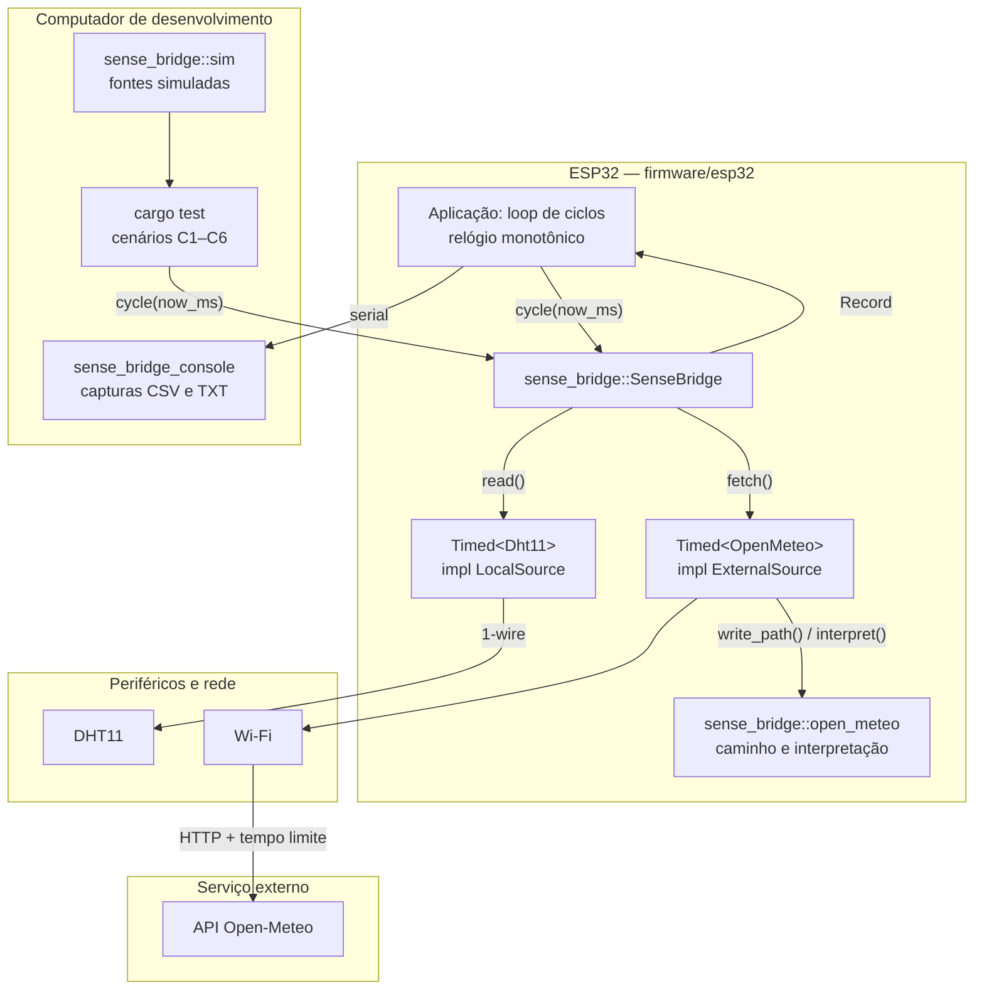
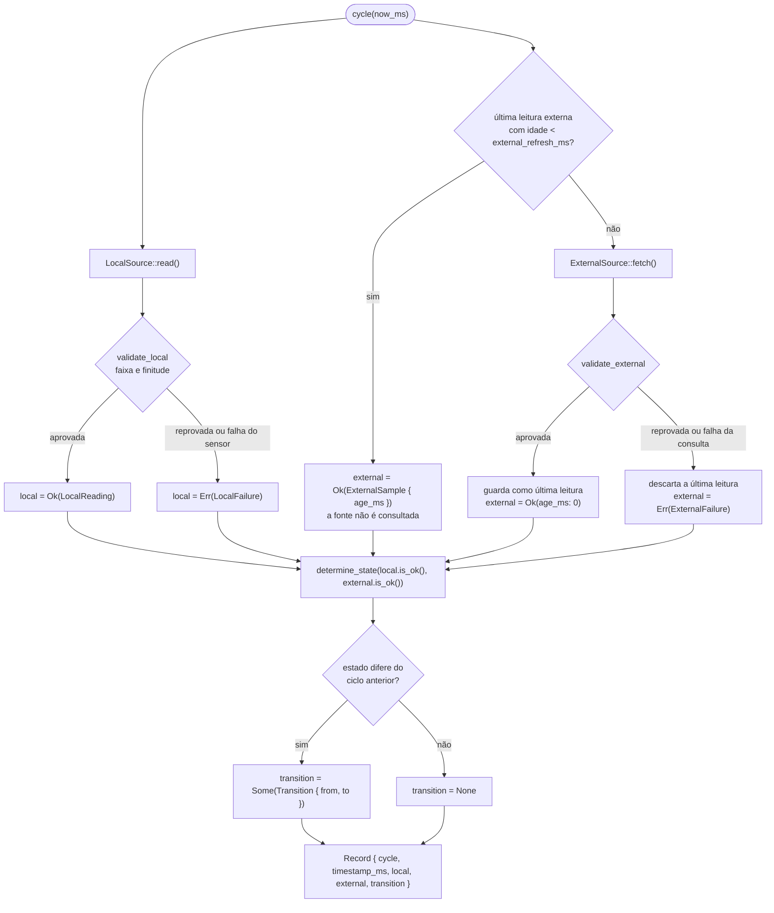
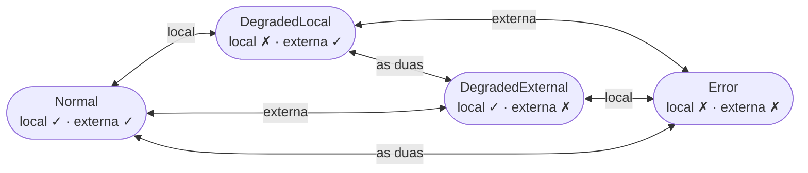

# Arquitetura

Como o sistema é construído hoje, e por quê. O que ele faz e as regras de negócio estão em [product.md](product.md). As decisões com alternativa descartada estão em `docs/memory/decisions/` (ADR-001 a ADR-010). Os motivos sem outra fonte indicada vêm do documento de arquitetura escrito pelos autores até 21/10/2026 (`docs/02-arch.md`, hoje no histórico do git).

## Visão geral

O repositório separa três coisas. A **biblioteca** `sense_bridge` não depende de hardware e é testada no computador. As **ferramentas de host** acompanham e analisam os experimentos. O **firmware de referência** roda no ESP32: ele implementa as duas fontes (DHT11 e Open-Meteo), chama o ciclo da biblioteca a cada 5 s e emite uma linha CSV por ciclo pela serial, que o console do host captura.

A biblioteca é o único ponto que combina as duas fontes, e o ciclo conhece cada uma apenas pela sua trait. Driver, pilha de rede, relógio e serialização ficam no firmware; `Timed` envolve cada fonte para medir a duração da consulta fora da biblioteca. Da Open-Meteo, a biblioteca oferece só a montagem da consulta e a interpretação da resposta, que a implementação da fonte externa usa ([ADR-008](../memory/decisions/ADR-008.md)).

## Componentes

| Componente | Responsabilidade | Código |
| --- | --- | --- |
| Crate `sense_bridge` | Núcleo: modelo de leituras e falhas, validação, ciclo de aquisição, estados de operação, registro integrado e detector de leitura congelada. Publicada no crates.io | `sense-bridge/` |
| Fontes simuladas | Resultado ajustável entre ciclos, com contagem de consultas, para reproduzir falha e recuperação sem hardware | `sense-bridge/src/sim.rs` |
| Testes de cenário | C1–C5, limites de validação, transições e intervalo de consulta externa; C6 simulado; respostas reais gravadas da Open-Meteo | `sense-bridge/tests/` |
| Exemplo | Percorre C1–C5 com fontes simuladas e imprime um registro por ciclo em CSV | `sense-bridge/examples/simulate.rs` |
| Console de host (`sense_bridge_console`) | Lê a saída do `espflash monitor`, mostra os ciclos, grava as capturas em TXT e CSV, confere cada captura com o estado esperado do seu cenário (`--analyze`) e mede sequências de leituras iguais (`--repeats`) | `tools/console/` |
| Firmware ESP32 (`sense_bridge_esp32`, não publicado) | Driver do DHT11, Wi-Fi, cliente Open-Meteo com tempo limite, relógio monotônico, cadência dos ciclos, instrumentação, saída CSV, reinício do DHT11 e injeção de falha do C6 | `firmware/esp32/` |
| Firmware-base | Firmware equivalente sem a biblioteca, usado só para medir o custo de Flash e RAM (D8) | `docs/evidencias/firmware/baseline/` |
| Evidências | Capturas oficiais dos experimentos e registro das verificações do código | `docs/evidencias/`, gerado em parte por `scripts/evidencias.sh` |

O workspace da raiz (`Cargo.toml`) contém só a crate e o console. O firmware fica fora dele, um projeto por placa em `firmware/`, com toolchain própria ([ADR-007](../memory/decisions/ADR-007.md)). Uma placa nova entra como projeto irmão, consumindo a mesma crate. O uso da API está no [README da crate](../../sense-bridge/README.md); a configuração, a ligação e o formato da saída do firmware, no [README do firmware](../../firmware/esp32/README.md).

### Módulos da crate

| Módulo | Tipos principais | Papel |
| --- | --- | --- |
| `bridge` | `SenseBridge<L, E>`, `Config` | Orquestra o ciclo: aquisição, validação, reuso da leitura externa, estado, transição e montagem do registro. Única parte com memória entre ciclos |
| `source` | `LocalSource`, `ExternalSource` | Fronteira com hardware e rede: é por onde, e só por onde, a plataforma entra na biblioteca |
| `reading` | `LocalReading`, `ExternalReading`, `LocalFailure`, `ExternalFailure`, `InvalidReason` | Modelo de dados e taxonomia de falhas, separada por fonte: um tipo de falha local não é expressável na externa, e vice-versa |
| `validation` | `Range`, `Limits`, `validate_local`, `validate_external` | Faixas com limites inclusivos e rejeição de valores não numéricos; `Limits::DHT11` e `Limits::PLAUSIBLE` seguem BR-10 e BR-11 |
| `state` | `OperationState`, `Transition`, `determine_state` | Estado derivado da disponibilidade e detecção de transição e recuperação. Função pura, sem memória |
| `record` | `Record`, `ExternalSample` | Saída de um ciclo: origem, validade, motivo da falha, idade da leitura externa e transição |
| `freeze` | `FreezeDetector` | Suspeita de leitura local congelada, opcional e fora do ciclo; não altera validade nem estado ([ADR-010](../memory/decisions/ADR-010.md)) |
| `sim` | `Simulated<T, F>`, `SimulatedLocal`, `SimulatedExternal` | Fontes controláveis para testes e exemplos no host |
| `open_meteo` | `HOST`, `write_path`, `interpret` | Caminho da consulta e interpretação da resposta, sem alocação nem E/S; usado pela implementação de `ExternalSource`, não pelo ciclo |

O estado retido em `SenseBridge` é deliberadamente mínimo: `next_cycle` (identificador sequencial), `state` (estado do ciclo anterior, para a transição) e `last_external` (última leitura externa válida e o instante em que foi obtida, para o reuso). A API pública é o que `lib.rs` reexporta; o resto é detalhe de implementação, mesmo em módulo público.

## Caminho principal: um ciclo

1. A aplicação chama `cycle(now_ms)` com o instante de um relógio monotônico. A cadência e o intervalo mínimo de amostragem do DHT11 são responsabilidade dela.
2. `LocalSource::read()` devolve a leitura ou uma `LocalFailure` de tipo identificado.
3. `validate_local` aplica `Limits` e converte a reprovação em `LocalFailure::Invalid(InvalidReason)`.
4. Se existe leitura externa guardada com idade menor que `external_refresh_ms`, ela é reutilizada e o registro informa `age_ms`; a fonte externa não é consultada nesse ciclo.
5. Caso contrário, `ExternalSource::fetch()` é chamado. O tempo limite é aplicado pela implementação, que devolve `ExternalFailure::Timeout` ao excedê-lo; a resposta passa por `validate_external`.
6. Qualquer falha na consulta ou na validação externa descarta a leitura guardada ([ADR-005](../memory/decisions/ADR-005.md)).
7. `determine_state` deriva o estado da disponibilidade das duas fontes naquele ciclo.
8. Se o estado difere do ciclo anterior, o registro carrega um `Transition`; `is_recovery()` identifica o retorno a `Normal`. No primeiro ciclo não há transição.
9. O `Record` volta para o firmware, que o serializa em CSV depois do trecho medido. Se `local_frozen_after` estiver ligado, o firmware alimenta o `FreezeDetector` com `Record::local`.

### Estados de operação

O estado é função da disponibilidade das duas fontes no ciclo (✓ disponível, ✗ indisponível), e qualquer estado pode seguir qualquer outro. Cada ligação vale nos dois sentidos e indica a fonte que muda; as que chegam a `Normal` são as recuperações.

## Stack

| Escolha | Por quê |
| --- | --- |
| Rust, edition 2024, `rust-version = 1.85` | Rust oferece "segurança de memória, abstrações de baixo nível e suporte a desenvolvimento com recursos restritos" ([projeto de pesquisa](../memory/2026-09-17-projeto-de-pesquisa-ptt4.pdf), §2.1). O motivo da versão mínima 1.85: não informado |
| Crate `no_std`, sem alocação e sem dependências | O alvo tem RAM e Flash restritas e o projeto mede o custo próprio da biblioteca: cada dependência entra nessa conta e precisa compilar para o alvo ([ADR-002](../memory/decisions/ADR-002.md)) |
| Fontes como traits genéricas, não `dyn` | Move a parte não determinística para fora do código testado, com custo nulo em tempo de execução, sem vtable no caminho do ciclo ([ADR-001](../memory/decisions/ADR-001.md)) |
| Tipos `Copy` e `Result` por fonte | Nada vai para o heap, e a indisponibilidade de uma fonte fica no tipo, não em sentinela ou flag paralela ([ADR-006](../memory/decisions/ADR-006.md)) |
| `f32` para temperatura e umidade | Precisão suficiente para as grandezas e mais barato que `f64` no ESP32; a finitude é checada na validação |
| Leitor JSON próprio para a Open-Meteo | A resposta é a entrada com mais casos de borda, e uma crate de JSON violaria a ADR-002 ([ADR-008](../memory/decisions/ADR-008.md)) |
| (D12) Firmware sobre ESP-IDF v5.5.5 e `esp-idf-svc`, com `std`, Wi-Fi e cliente HTTP, toolchain `esp` do espup, alvo Xtensa ESP32 | Não informado |
| (D13) DHT11 lido pela crate `dht11-trace`, de autoria própria | Identifica a etapa do protocolo em que a leitura falhou e lê o quadro sem interrupções, mantendo o protocolo fora da biblioteca ([ADR-009](../memory/decisions/ADR-009.md)) |
| Console lê o `espflash monitor` pela entrada padrão | O espflash cuida da porta, do reset e dos símbolos, e a ferramenta não precisa de crate serial nem de dependência nativa (commit `936818d`) |

Não há banco nem persistência no dispositivo: o estado vive em memória durante a execução. As capturas de trabalho ficam em `capturas/`, fora do git; as oficiais, em `docs/evidencias/`.

## Integrações externas

| Serviço | Usado para | Configuração |
| --- | --- | --- |
| Open-Meteo (`api.open-meteo.com`, por HTTP sem TLS) | Temperatura e umidade atuais do local configurado, como contexto (BR-16) | `latitude`, `longitude`, `http_timeout_ms` e `external_refresh_ms` em `firmware/esp32/cfg.toml` |
| Wi-Fi de 2,4 GHz | Acesso à Open-Meteo | `wifi_ssid` e `wifi_password` em `firmware/esp32/cfg.toml`, ignorado pelo git; o modelo é `cfg.toml.example` |

Quando a Open-Meteo ou o Wi-Fi falham, a fonte externa fica indisponível, o estado passa a `DegradedExternal` ou `Error`, e a consulta é repetida a cada ciclo (BR-08, BR-09). Os testes usam respostas reais gravadas em `sense-bridge/tests/fixtures/open_meteo/`, nunca a rede.

A consulta usa `http://` desde o primeiro firmware (commit `70c6411`, "Open-Meteo over HTTP"), e o firmware-base também usa HTTP. Assim, as latências de C1–C5 e o custo de Flash e RAM (D8) foram medidos sem TLS. O PRD descrevia a pilha da D12 como "Wi-Fi, TLS e HTTP", mas o código nunca usou TLS; o texto foi corrigido aqui para refletir o código. Passar a usar HTTPS está nas perguntas em aberto de [product.md](product.md).

## Observabilidade

A biblioteca não registra log, não aloca e não imprime: **o próprio `Record` é a telemetria**. Como `timestamp_ms` vem do chamador e a biblioteca não lê relógio, toda medição de tempo acontece fora dela ([ADR-003](../memory/decisions/ADR-003.md)). As durações de cada ciclo ficam em memória, e a linha CSV só é emitida depois do ciclo, fora da janela medida.

| O quê | Onde olhar |
| --- | --- |
| Registros e transições | `Record` devolvido por `cycle`; uma linha CSV por ciclo na serial, com o cabeçalho em `firmware/esp32/src/csv_header.in`, compartilhado pelo firmware e pelo console |
| Latência da leitura local, da consulta externa e do ciclo | Colunas `read_us`, `fetch_us` e `cycle_us` do CSV; validação e integração são `cycle_us − read_us − fetch_us` (BR-33) |
| RAM em execução | Heap livre, menor heap livre e folga mínima da pilha, no CSV |
| Flash e RAM estática | `xtensa-esp32-elf-size` do firmware completo e do firmware-base, em `docs/evidencias/firmware/` |
| Suspeita de leitura congelada e reinício do DHT11 | Colunas `local_repeat`, `local_suspect` e `local_restart` no fim do CSV e aviso no log, com `local_frozen_after` e `local_frozen_restart` |
| Etapa do protocolo em que a leitura do DHT11 falhou | Log do firmware, a partir da `dht11-trace` |
| Resumo e conferência de uma captura | `sense_bridge_console`: resumo por estado e por tipo de falha; `--analyze` para o estado esperado de C1–C6 |
| Verificações do código | `docs/evidencias/verificacao.md`, gerado por `scripts/evidencias.sh` |

## Invariantes

| Invariante | Por quê | Verificado por |
| --- | --- | --- |
| O hardware fica fora da crate: nenhum módulo depende de HAL, pilha de rede, relógio, alocador ou `std`; a plataforma entra por parâmetro ou por trait | Mantém o núcleo testável sem hardware e reutilizável em outras placas ([ADR-001](../memory/decisions/ADR-001.md), [ADR-002](../memory/decisions/ADR-002.md)) | CI, job `no-std` (`cargo build -p sense_bridge --target thumbv7em-none-eabihf`) |
| `[dependencies]` da crate fica vazio, e a crate não usa `alloc` | Cada dependência entra na conta de Flash do experimento e precisa compilar para o alvo ([ADR-002](../memory/decisions/ADR-002.md)) | Revisão (pergunta em aberto em [product.md](product.md)) |
| A crate compila e passa nos testes com Rust 1.85 | É o `rust-version` declarado da crate publicada | CI, job `msrv` |
| Nada inválido chega ao `Record` como válido: `Ok` só existe para leitura aprovada | É a meta Q1, o critério central do projeto (BR-12, BR-15) | `values_just_outside_range_are_rejected`, `non_finite_values_are_rejected` (`sense-bridge/src/validation.rs`); `invalid_local_reading_makes_local_source_unavailable`, `invalid_external_reading_makes_external_source_unavailable` (`sense-bridge/tests/scenarios.rs`) |
| As fontes não se misturam, e a divergência não altera validade nem estado | BR-16, BR-21 | `divergence_between_sources_does_not_change_state` (`sense-bridge/tests/scenarios.rs`) |
| O estado é função pura da disponibilidade no ciclo; a única memória entre ciclos é o estado anterior e a última leitura externa válida | Outra memória criaria caminhos que os testes de cenário não cobrem (BR-23, [ADR-004](../memory/decisions/ADR-004.md)) | Testes de `sense-bridge/src/state.rs`; `c1_` a `c5_` em `sense-bridge/tests/scenarios.rs` |
| Toda falha externa descarta a leitura guardada | BR-08, [ADR-005](../memory/decisions/ADR-005.md) | `failed_fetch_discards_previous_external_reading` (`sense-bridge/tests/scenarios.rs`) |
| A biblioteca não entra em pânico nem para de tentar, inclusive em `Error` | BR-27 | `c4_simultaneous_failure_reports_error_and_keeps_polling` (`sense-bridge/tests/scenarios.rs`) |
| Um registro por ciclo, com identificador que cresce de um em um; transição só quando o estado muda | BR-19, BR-20, BR-25 | `cycle_ids_increase_by_one`, `transitions_are_reported_only_when_state_changes` (`sense-bridge/tests/scenarios.rs`) |
| O `FreezeDetector` não altera validade nem estado | BR-18, [ADR-010](../memory/decisions/ADR-010.md) | `c6_frozen_reading_is_suspect_but_stays_valid_and_normal` (`sense-bridge/tests/frozen.rs`) |
| Os nomes de estados e falhas de `as_str()` são contrato (o CSV e o console dependem deles); a saída de `Debug` não é | Os nomes fazem parte da API (documento de arquitetura anterior); mudar um quebra as capturas versionadas e o `--analyze` | `state_names_are_stable` (`sense-bridge/src/state.rs`), `failure_names_are_stable` (`sense-bridge/src/reading.rs`) |
| Todo item público da crate é documentado | A API documentada é um entregável do projeto de pesquisa (§6.1) | `#![warn(missing_docs)]` em `sense-bridge/src/lib.rs`, com `cargo clippy --all-targets -- -D warnings` na CI |
| O caminho da consulta gravado nas respostas de teste é o mesmo que o firmware usa | Suposição, não confirmada: as respostas gravadas só valem se corresponderem à consulta real | `request_path_matches_the_query_used_to_record_the_fixtures` (`sense-bridge/tests/open_meteo.rs`) |

## Convenções

- Tempo em milissegundos (`u64`) de relógio monotônico, sempre fornecido pelo chamador; diferenças com `saturating_sub`. Um relógio que retroceda não produz idade negativa, mas a biblioteca não detecta o retrocesso.
- Faixas são intervalos fechados: o valor exatamente no limite é válido (BR-14).
- O identificador de ciclo começa em 0 e só cresce.
- Documentação e comentários em português; nomes de código em inglês.
- Testes unitários junto do módulo (`#[cfg(test)]`); cenários do protocolo em `sense-bridge/tests/`, nomeados pelo comportamento verificado.
- Clippy sem avisos, com avisos tratados como erro.
- O firmware compila com a toolchain da placa, dentro de `firmware/<placa>/`, e fica fora da CI.
